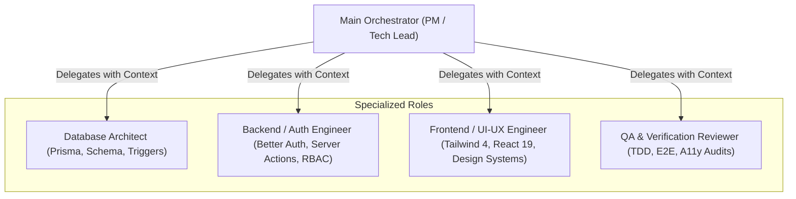

# Agentic Development Workflow

**Document Purpose**: Define the collaboration protocols, orchestration guidelines, skill integration workflows, and context handoff rules for all AI agents working on this project.  
**Last Updated**: 2026-11-18  
**Authoritative Status**: Approved AI Operating Rules  

---

## 1. Core Operating Principles

1. **Context-First Execution**: No agent may begin a task without reading the relevant authoritative documentation in `docs/`. Chat history is ephemeral; `docs/` is persistent.
2. **Strict Plan-First Workflow**: Substantial architectural changes, schema updates, or multi-step feature implementations must produce a structured implementation plan and obtain human approval before code is authored.
3. **The Iron Law of TDD**: No production code may be written without a failing test first. Adherence to Superpowers' `test-driven-development` skill is non-negotiable.
4. **No Redundant Agent or Skill Creation**: Existing capabilities provided by **Superpowers** (TDD, worktrees, planning, code review), **UI UX Pro Max** (design intelligence, palettes, typography), and **Prisma** must be used directly. Do not create redundant wrapper agents or duplicate skills.
5. **Human Approval Gates**: Significant decisions (database migrations, design identity approval, business rule alterations) require explicit human consent.

---

## 2. Orchestration & Role Specialization

### Role Boundaries:
- **Main Orchestrator**:
  - Maintains project phase progression against `docs/DEVELOPMENT_ROADMAP.md`.
  - Determines which `docs/*.md` files are relevant to each task.
  - Passes explicit context paths to delegated subagents.
  - Verifies evidence before declaring milestone completion.
- **Database Architect**:
  - Owns `prisma/schema.prisma`, `prisma.config.ts`, PostgreSQL migration drafts, indexes, and referential constraints.
  - Consults `docs/DATABASE_DESIGN.md` and `docs/BUSINESS_RULES.md`.
- **Backend / Auth Engineer**:
  - Owns Better Auth configuration, Next.js Server Actions, RBAC checks, and Zod validation schemas.
  - Consults `docs/ARCHITECTURE.md` and `docs/REQUIREMENTS.md`.
- **Frontend / UI-UX Engineer**:
  - Owns components, layouts, responsive design, and Tailwind CSS v4 styling.
  - Consults `docs/DESIGN_GUIDELINES.md` and UI UX Pro Max skills.
- **QA & Testing Reviewer**:
  - Owns test suites, edge case verification, and accessibility audits.
  - Enforces Superpowers TDD practices.

---

## 3. Superpowers Framework Integration

All agents must follow the Superpowers workflow methodology:

- **Brainstorming (`superpowers:brainstorming`)**:
  - Mandatory before designing any new feature or proposing behavioral changes.
- **Writing Plans (`superpowers:writing-plans`)**:
  - Mandatory before authoring code for any multi-step task.
- **Test-Driven Development (`superpowers:test-driven-development`)**:
  - Red-Green-Refactor cycle: Write failing test -> confirm test fails -> write minimal implementation -> pass test -> refactor.
- **Verification Before Completion (`superpowers:verification-before-completion`)**:
  - Assertions of success must always be backed by live command execution logs and test output. Never claim a task is complete based solely on compilation or lack of syntax errors.
- **Code Review (`superpowers:requesting-code-review` / `receiving-code-review`)**:
  - Structured review loops prior to finalizing tasks or closing development branches.

---

## 4. UI UX Pro Max Skill Integration

- When designing or styling user interfaces:
  1. Do not invent arbitrary styling or rely on generic "AI dashboard" templates.
  2. Query `ui-ux-pro-max` databases for component patterns, font pairings, and contrast ratios.
  3. Strictly adhere to the typography scale, color tokens, and layout guidelines codified in `docs/DESIGN_GUIDELINES.md` (once approved in Stage B.4).
  4. Ensure WCAG 2.1 AA accessibility compliance for every interactive component.

---

## 5. Context Handoff Protocol

When the Orchestrator delegates a task to a specialized agent, it must provide a structured brief:
1. **Goal & Scope**: Exactly what must be accomplished.
2. **Relevant Context Files**: Explicit list of `docs/*.md` files the agent must read before acting.
3. **Acceptance Criteria**: Concrete, measurable conditions for completion.
4. **Applicable Skills**: Required Superpowers or domain skills to invoke.

---

## 6. Conflict Resolution & Authority

- If an instruction or prompt contradicts an approved statement in `docs/`, the agent must **pause**, flag the discrepancy, and request human clarification.
- Agents must never silently modify approved architectural decisions or business invariants.
