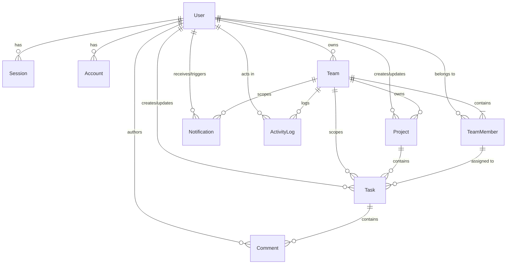

# Database Design & Relational Architecture

**Document Purpose**: Provide the complete database specification, entity relationship architecture, constraint rules, Better Auth mapping, and PostgreSQL integrity strategies.  
**Last Updated**: 2026-11-18  
**Authoritative Status**: Approved Database Design  

---

## 1. Entity Relationship Model

The database enforces a hierarchical, multi-tenant relational schema:



---

## 2. UUID Primary Key Architecture

- Every table utilizes standard **RFC 4122 UUID** primary keys:
  ```prisma
  id String @id @default(uuid()) @db.Uuid
  ```
- Better Auth is explicitly configured with `advanced: { database: { generateId: "uuid" } }` in `src/lib/auth.ts`, ensuring zero type mismatches across authentication and application tables.

---

## 3. Team Isolation & Composite Constraints

To guarantee tenant boundaries at the database engine level (independent of application code bugs):
- **Project Isolation**: `Project` enforces `@@unique([id, teamId])`.
- **Task Isolation**:
  - `Task` enforces `@@unique([id, teamId])`.
  - Links to parent project via composite foreign key: `fields: [projectId, teamId], references: [id, teamId]`.
  - Links to assignee via composite foreign key: `fields: [teamId, assignedToId], references: [teamId, userId]`. This makes it mathematically impossible to assign a task to a user who is not an active member of that exact team.
- **Comment Isolation**:
  - `Comment` enforces `@@unique([id, teamId])`.
  - Links to task via composite foreign key: `fields: [taskId, teamId], references: [id, teamId]`.
- **Activity Log Isolation**:
  - All logs reference `teamId` directly.
  - Target references (`project`, `task`, `comment`) link using composite `[entityId, teamId]` foreign keys.

---

## 4. Referential Actions & User Account Anonymization Lifecycle

### A. Referential Actions Overview

| Relation | Foreign Key | Referential Action (`onDelete`) | Architectural Behavior |
| :--- | :--- | :--- | :--- |
| **Team -> Owner** | `team.ownerId -> user.id` | `Restrict` | Prevents deleting/anonymizing a user account while they remain an active owner of a team. |
| **TeamMember -> Team** | `team_member.teamId -> team.id` | `Cascade` | Deleting a team cleans up its member records. |
| **TeamMember -> User** | `team_member.userId -> user.id` | `Cascade` | Deleting/anonymizing a user cleans up their non-owner memberships. |
| **Task -> Assignee** | `task.[teamId, assignedToId] -> team_member.[teamId, userId]` | `Restrict` | Prevents removing a team member who is currently assigned to open tasks without reassigning first. |
| **Project -> CreatedBy** | `project.createdById -> user.id` | `Restrict` | Retains project audit trail; blocks raw user row deletion. |
| **Task -> CreatedBy** | `task.createdById -> user.id` | `Restrict` | Retains task author audit trail; blocks raw user row deletion. |
| **Project -> UpdatedBy** | `project.updatedById -> user.id` | `SetNull` | Preserves record even if updater account is removed. |
| **Task -> UpdatedBy** | `task.updatedById -> user.id` | `SetNull` | Preserves record even if updater account is removed. |
| **Comment -> User** | `comment.userId -> user.id` | `SetNull` | Preserves comment text and discussion history if author departs. |
| **ActivityLog -> Actor** | `activity_log.actorId -> user.id` | `SetNull` | Preserves permanent immutable audit trail. |

### B. User Account Anonymization Lifecycle (Decision H.4)

Because `project.createdById`, `task.createdById`, and `team.ownerId` use `onDelete: Restrict`, issuing a raw SQL `DELETE FROM "user"` on an active user with historical records is physically blocked by PostgreSQL foreign key constraints. 

To satisfy privacy mandates while preserving permanent project history:
1. **Account Deletion = Anonymization**: Account deletion is implemented as an **anonymization mutation**, *never* a physical user row deletion.
2. **Scrubbing Personal Data**:
   - `User.name` is replaced with `"Deleted User"`.
   - `User.email` is replaced with an anonymous non-routable tombstone (`deleted_<uuid>@deleted.local`), releasing the user's original email for future re-registration.
   - `User.image` is cleared to `null`.
   - Credentials (hashed passwords) are cleared.
   - Linked OAuth `Account` records are revoked and deleted.
   - All active `Session` records are invalidated.
   - `User.deletedAt` timestamp is set to `now()`.
3. **Foreign Key Integrity**: The internal `User.id` (UUID) remains in the database. All existing foreign keys referencing `createdById` remain completely intact without violating `Restrict`. Historical projects, tasks, comments, and activity logs remain accessible with author attribution masked as `"Deleted User"`.
4. **Ownership Guard**: An `OWNER` cannot undergo anonymization while owning an active team (per BR-TEAM-03). Ownership must be transferred or the team deleted first.
5. *Pending Technical Validation*: Exact Better Auth webhook/plugin hooks for account cleanup will be validated during Phase 1 implementation.

---

## 5. Better Auth Model Mapping

Better Auth core models are mapped cleanly into PostgreSQL tables:
- `User` -> Table `"user"`
- `Session` -> Table `"session"` (with `userId` UUID cascade)
- `Account` -> Table `"account"` (with OAuth token fields)
- `Verification` -> Table `"verification"` (for email tokens)

---

## 6. Custom PostgreSQL SQL Integrity Strategies

Prisma ORM cannot natively validate cross-table state synchronization or conditional deferrals. The following custom PostgreSQL mechanisms are specified for the initial migration:

### A. Single Team Owner Integrity Architecture (Partial Unique Index + Deferred Trigger)

The system enforces a dual-layer guarantee for team ownership:

1. **Storage Engine Upper-Bound Guarantee (Partial Unique Index)**:
   - A partial unique index on `team_member` guarantees that at any point in time, a team can have **at most one** member with `role = 'OWNER'`.
   - Any concurrent attempt to insert or promote a second owner is immediately rejected by PostgreSQL's B-tree index engine, preventing race conditions and write-skew.
   ```sql
   CREATE UNIQUE INDEX "idx_team_single_owner"
   ON "team_member" ("teamId")
   WHERE ("role" = 'OWNER');
   ```

2. **Transactional Lower-Bound & Synchronization Guarantee (Deferred Constraint Trigger)**:
   - While the unique index guarantees *at most one* owner, the deferred trigger guarantees that at transaction `COMMIT`, every active team has **at least one** owner, and that `team.ownerId` matches that user's `userId`.
   - **The Coverage Requirement**: Evaluates mutations on:
     1. `team`: On `INSERT` and `UPDATE` (e.g. creating team, changing `ownerId`).
     2. `team_member`: On `INSERT`, `UPDATE`, and `DELETE` (e.g. adding members, promoting/demoting roles, removing members).
   - **Handling Lifecycle Scenarios**:
     - *Team Creation*: Atomically inserts `team` and `team_member (role=OWNER)` inside a `$transaction`. Because the constraint is `DEFERRED`, the invariant is checked at `COMMIT` time, preventing circular FK errors during intermediate insertion.
     - *Ownership Transfer*: Inside a `$transaction`, demotes old owner (`role = 'MEMBER'`), promotes new owner (`role = 'OWNER'`), and updates `team.ownerId`. The unique index permits this sequence because the old owner is demoted before the new owner is promoted. The trigger validates the final state at `COMMIT`.
     - *Cross-Team Membership Move*: If an `UPDATE` changes a member's `teamId`, the trigger validates both `OLD.teamId` and `NEW.teamId` to ensure the source team is not left without an owner.
     - *Role Changes & Demotions*: If an operation updates the owner's role to `MEMBER` without a corresponding new owner, the trigger throws an exception at `COMMIT`.
     - *Owner Removal*: If an operation deletes the owner's `team_member` row without a replacement, the trigger throws an exception at `COMMIT`.
     - *Team Deletion*: Cascades to `team_member`, deleting both atomically. If the team no longer exists, the check is skipped.

```sql
-- Trigger Function: Enforces Single Team Owner Invariant
CREATE OR REPLACE FUNCTION public.verify_team_owner_invariant() RETURNS TRIGGER AS $$
DECLARE
  teams_to_check UUID[];
  target_team_id UUID;
  owner_count INT;
  actual_owner UUID;
  team_exists BOOLEAN;
BEGIN
  -- Collect team IDs that require invariant validation
  IF TG_TABLE_NAME = 'team' THEN
    IF TG_OP = 'INSERT' THEN
      teams_to_check := ARRAY[NEW."id"];
    ELSIF TG_OP = 'UPDATE' THEN
      IF NEW."id" IS DISTINCT FROM OLD."id" THEN
        teams_to_check := ARRAY[OLD."id", NEW."id"];
      ELSE
        teams_to_check := ARRAY[NEW."id"];
      END IF;
    END IF;
  ELSE -- TG_TABLE_NAME = 'team_member'
    IF TG_OP = 'INSERT' THEN
      teams_to_check := ARRAY[NEW."teamId"];
    ELSIF TG_OP = 'DELETE' THEN
      teams_to_check := ARRAY[OLD."teamId"];
    ELSIF TG_OP = 'UPDATE' THEN
      IF NEW."teamId" IS DISTINCT FROM OLD."teamId" THEN
        teams_to_check := ARRAY[OLD."teamId", NEW."teamId"];
      ELSE
        teams_to_check := ARRAY[NEW."teamId"];
      END IF;
    END IF;
  END IF;

  -- Validate each affected team
  FOREACH target_team_id IN ARRAY teams_to_check
  LOOP
    -- Skip validation if target team ID is NULL
    IF target_team_id IS NULL THEN
      CONTINUE;
    END IF;

    -- Check if team still exists (handles team deletion cascade)
    SELECT EXISTS(SELECT 1 FROM "team" WHERE "id" = target_team_id) INTO team_exists;
    IF NOT team_exists THEN
      CONTINUE;
    END IF;

    -- Validate exact owner count on team_member
    SELECT COUNT(*) INTO owner_count
    FROM "team_member"
    WHERE "teamId" = target_team_id AND "role" = 'OWNER';

    IF owner_count != 1 THEN
      RAISE EXCEPTION 'Team % must have exactly 1 OWNER (found %)', target_team_id, owner_count;
    END IF;

    -- Retrieve the single OWNER UUID (guaranteed exactly 1 row when owner_count = 1)
    SELECT "userId" INTO actual_owner
    FROM "team_member"
    WHERE "teamId" = target_team_id AND "role" = 'OWNER'
    LIMIT 1;

    -- Validate team.ownerId matches team_member OWNER
    IF NOT EXISTS (
      SELECT 1 FROM "team"
      WHERE "id" = target_team_id AND "ownerId" = actual_owner
    ) THEN
      RAISE EXCEPTION 'Team % ownerId does not match OWNER membership', target_team_id;
    END IF;
  END LOOP;

  RETURN NULL;
END;
$$ LANGUAGE plpgsql;

-- Constraint Trigger on "team"
CREATE CONSTRAINT TRIGGER trg_verify_team_owner_team
AFTER INSERT OR UPDATE ON "team"
DEFERRABLE INITIALLY DEFERRED
FOR EACH ROW EXECUTE FUNCTION verify_team_owner_invariant();

-- Constraint Trigger on "team_member"
CREATE CONSTRAINT TRIGGER trg_verify_team_owner_member
AFTER INSERT OR UPDATE OR DELETE ON "team_member"
DEFERRABLE INITIALLY DEFERRED
FOR EACH ROW EXECUTE FUNCTION verify_team_owner_invariant();
```

### B. Clean Active Team Context on Member Removal
- An `AFTER DELETE` trigger on `team_member` resets `user.lastActiveTeamId` to `NULL` if the deleted membership matches the user's active team pointer:
  ```sql
  CREATE OR REPLACE FUNCTION clean_last_active_team() RETURNS TRIGGER AS $$
  BEGIN
    UPDATE "user"
    SET "lastActiveTeamId" = NULL
    WHERE "id" = OLD."userId" AND "lastActiveTeamId" = OLD."teamId";
    RETURN OLD;
  END;
  $$ LANGUAGE plpgsql;

  CREATE TRIGGER trg_clean_last_active_team
  AFTER DELETE ON "team_member"
  FOR EACH ROW EXECUTE FUNCTION clean_last_active_team();
  ```

### C. Project Date Ordering Constraint
- To guarantee that a project's end date never precedes its start date at the database engine level:
  ```sql
  ALTER TABLE "project"
  ADD CONSTRAINT chk_project_dates
  CHECK ("endDate" IS NULL OR "startDate" IS NULL OR "endDate" >= "startDate");
  ```

### D. Activity Log Append-Only Enforcement (Deferred to Phase 4)
- In Phase 3 (Milestone 3.1), `activity_log` immutability (`BR-AUDIT-01`) is enforced at the application layer via the centralized append-only writer (`src/features/activity/writer.ts`) with no `UPDATE` or `DELETE` paths. Database-level trigger enforcement (`BEFORE UPDATE OR DELETE` on `"activity_log"`) is deferred to Phase 4 hardening; no schema or migration changes are introduced in Milestone 3.1.

---

## 7. Neon Connection Architecture

- **Runtime Operations**: Use pooled connection string (`DATABASE_URL`, pooler port 5432/6543) wrapped in `@prisma/adapter-pg`.
- **Migrations & CLI Operations**: Use direct connection string (`DIRECT_URL`, non-pooler endpoint) in `prisma.config.ts` to support migration-level locks and schema diffing.

---

## 8. Open Questions & Technical Concerns

> [!WARNING]
> - **Open Question 1 (Invitation Workflow)**: Whether team member additions in the MVP require email verification tokens or direct user addition by existing registered email.
> - **Open Question 2 (Task Drag-and-Drop Order)**: **Resolved (Milestone 2.3)** — Columns sort deterministically by priority (`HIGH` → `MEDIUM` → `LOW`), earliest non-null `dueDate` (nulls last), `createdAt` descending, then `id` ascending; no `order` column or schema migration required.
> - **Open Question 3 (Soft-Delete Project Name Re-use)**: Whether soft-deleted projects or teams allow name re-use within the same team scope (requiring a partial unique index).
> - **Open Question 4 (Member Task Self-Deletion)**: Whether a standard `MEMBER` should be permitted to soft-delete tasks they personally created if no progress has started (`TODO` status). Currently restricted to `OWNER` and `MANAGER`.
