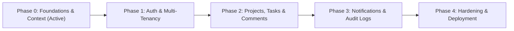

# Development Roadmap

**Document Purpose**: Define the sequential development phases, dependencies, MVP implementation milestones, and verification gates for the application.  
**Last Updated**: 2026-11-18  
**Authoritative Status**: Approved Roadmap  

---

## 1. Roadmap Architecture & Phase Progression

Development is organized into five strict phases. No feature code in Phase 1+ may begin until the foundational architecture and context in Phase 0 are finalized and approved.

---

## 2. Phase 0: Foundations, Governance & Context (CURRENT)

*Goal: Establish tooling, persistent agent context, visual identity, and verified database specifications without implementing application features.*

- [x] **Stage A**: Repository inspection, Prisma schema review, Better Auth mapping, implementation planning. *(Complete)*
- [x] **Stage B.1**: Installation and verification of **Superpowers** (`v7.0.2`) and **UI UX Pro Max** (`v2.4.1`). *(Complete)*
- [x] **Stage B.2**: Persistent Project Context setup (`docs/*` suite and root `AGENTS.md`) and Comprehensive Decisions Audit. *(Complete)*
- [x] **Stage B.3**: Visual Design Identity exploration via UI UX Pro Max and **Human Approval Gate** (Hybrid Direction approved). *(Complete)*
- [x] **Stage B.4**: Codification of approved visual identity into `docs/DESIGN_GUIDELINES.md`. *(Complete)*
- [x] **Stage B.5**: Database preparation, `prisma7.config.ts`, PostgreSQL migration DDL with custom deferred triggers, partial unique index, and successful deployment to Neon. *(Complete)*

---

## 3. Phase 1: Authentication & Workspace Multi-Tenancy

*Goal: Enable secure user registration, session management, and multi-tenant team workspace isolation.*

- **Milestone 1.1**: Better Auth API routes and server-side session integration (`src/features/auth/`).
- **Milestone 1.2**: Sign up, sign in, email verification, password reset, and Google OAuth flows.
- **Milestone 1.3**: Team workspace creation and dynamic routing using approved URL pattern (`src/app/(dashboard)/teams/[teamId]/`).
- **Milestone 1.4**: Team member addition, role assignment (`OWNER`, `MANAGER`, `MEMBER`), and atomic ownership transfer.
- **Milestone 1.5**: Active team context persistence (`lastActiveTeamId`) as navigation preference.
- **Milestone 1.6**: User account deletion via anonymization lifecycle (scrubbing personal info while preserving historical projects and tasks).

---

## 4. Phase 2: Core Project & Task Management

*Goal: Deliver full project and task progression capabilities within team boundaries.*

- **Milestone 2.1**: Project CRUD, status lifecycles (`PLANNING`, `ACTIVE`, `ON_HOLD`, `COMPLETED`, `CANCELLED`), project dates validation (`endDate >= startDate`), and project views.
- **Milestone 2.2**: Task management: creation, editing, priority levels (`LOW`, `MEDIUM`, `HIGH`, default: `MEDIUM`), due dates, and same-team assignee selection.
- **Milestone 2.3**: Interactive Kanban board (`TODO`, `IN_PROGRESS`, `IN_REVIEW`, `DONE`) with responsive layout.
- **Milestone 2.4**: Multi-criteria task filtering (status, priority, assignee, due date), keyword search, and sorting (due date, priority, createdAt, title).
- **Milestone 2.5**: Task comments thread with author-only editing and manager/owner deletion moderation.

---

## 5. Phase 3: Notifications & Audit Infrastructure

*Goal: Provide team transparency, historical audit trails, and timely user notifications.*

- **Milestone 3.1**: Activity logging subsystem capturing project and task mutations in immutable logs.
- **Milestone 3.2**: Team activity timeline view.
- **Milestone 3.3**: In-app notification dispatching on assignment, status updates, and mentions (standard HTTP revalidation; no WebSockets in MVP).
- **Milestone 3.4**: In-app notification center (unread counters, mark as read).
- **Milestone 3.5**: Team dashboard summary (metrics, upcoming deadlines, status distribution).

---

## 6. Phase 4: Production Hardening, Quality & Deployment

*Goal: Validate complete system reliability, performance, accessibility, and deploy to production.*

- **Milestone 4.1**: Comprehensive end-to-end integration test suite asserting cross-team isolation and RBAC using Superpowers TDD practices.
- **Milestone 4.2**: Full accessibility audit verifying WCAG 2.1 AA compliance across all views.
- **Milestone 4.3**: Performance optimization (LCP, bundle splitting, query caching).
- **Milestone 4.4**: Production deployment to Vercel (Next.js 16) and Neon PostgreSQL free-tier.

---

## 7. Open Questions & Pending Decisions

> [!WARNING]
> The following items are explicitly recorded as unresolved pending technical/product alignment:
> - **Open Question 1 (Invitation Workflow)**: Whether team member additions in the MVP require email verification tokens or direct user addition by existing registered email.
> - **Open Question 2 (Task Drag-and-Drop Order)**: Whether Kanban board columns require a dedicated integer `order` index per task or sort deterministically by priority and creation date in the MVP.
> - **Open Question 3 (Soft-Delete Project Name Re-use)**: Whether soft-deleted projects or teams allow name re-use within the same team scope (requiring a partial unique index).
> - **Open Question 4 (Member Task Self-Deletion)**: Whether a standard `MEMBER` should be permitted to soft-delete tasks they personally created if no progress has started (`TODO` status). Currently restricted to `OWNER` and `MANAGER`.
> - **Open Question 5 (Staging Environment Branching)**: Whether Neon database branching should be automated in CI/CD for pull request preview deployments.
